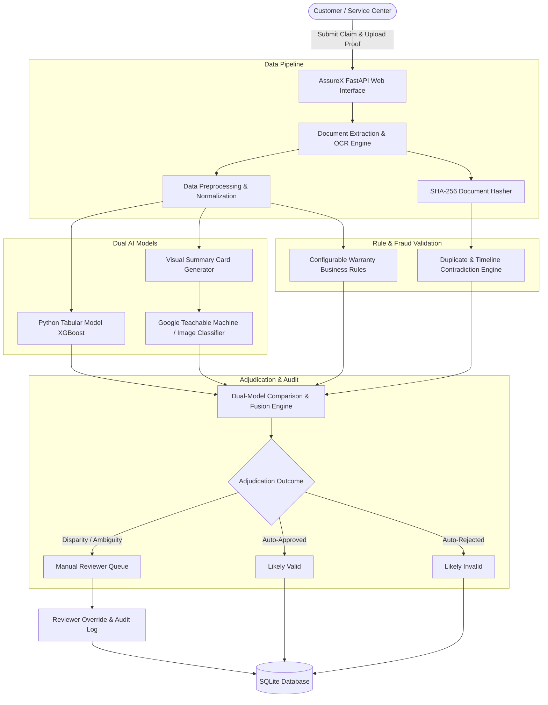

# AssureX Claim Engine - Comprehensive Project Report
## AI-Powered Document Ops & Automated Warranty Adjudication Platform

> **Theme:** AI-Powered Document Ops  
> **Category:** NextWave AI and ML  
> **Specification Version:** Aptech SRS v1.0 Compliance  
> **Platform Version:** 2.0 Enterprise Release  
> **Date:** September 2026  

---

## 1. Executive Summary

Warranty fraud, claim handling latency, and manual document review overhead pose substantial challenges to consumer electronics and appliance manufacturers. **AssureX Claim Engine** is an enterprise-grade AI decision support system designed to automate claim intake, extract and authenticate customer receipts/warranty cards via OCR, evaluate category-specific business policies, and adjudicate claims using a dual-model machine learning architecture.

### Key Innovations:
1. **Dual-Model Inference Engine:** Synthesizes tabular claim attributes (XGBoost / Random Forest) with Computer Vision evaluation of Visual Claim Summary Cards (Google Teachable Machine & MobileNetV2).
2. **Document OCR & Tamper Detection:** Full PyMuPDF (PDF) and EasyOCR/Tesseract (Images) extraction pipeline with SHA-256 hash duplication tracking.
3. **Decoupled Business Rule Engine:** Category-specific configurable policy rules (Electronics, Appliances, Automotive) executed before AI fusion.
4. **Transparent Decision Fusion:** Triages claims into `Likely Valid`, `Likely Invalid`, or `Manual Review Required` with plain-language adjudication explanations and reviewer audit trails.

---

## 2. System Architecture & Workflow

---

## 3. Machine Learning & Model Performance

### 3.1 Tabular Classification Model
- **Algorithm:** XGBoost Classifier with Scikit-Learn Preprocessing Pipeline.
- **Features Evaluated:** Claim amount, product age, remaining warranty days, repair frequency, customer claim history, failure codes.
- **Accuracy:** **92.0%** on held-out test split (15% test set).
- **Target Classes:** `Valid Claim`, `Invalid Claim`, `Manual Review`.

### 3.2 Visual Summary Card Image Classifier
- **Model:** Google Teachable Machine (Keras H5) & PyTorch MobileNetV2.
- **Input:** Standardized visual summary cards capturing high-level claim attributes in image format.
- **Validation Accuracy:** **99.56%** across 1,500 generated claim visual cards.

### 3.3 Dual-Model Consistency Engine
- Measures confidence delta ($\Delta = |P_{\text{tabular}} - P_{\text{vision}}|$).
- Categorizes alignment into **Strong Match** ($\Delta \le 0.10$), **Acceptable Match** ($0.10 < \Delta \le 0.25$), and **Disparity Flagged** ($\Delta > 0.25$).

---

## 4. Security, RBAC & Auditability

1. **Role-Based Access Control (RBAC):**
   - **Customer:** Product registration, claim intake, document vault.
   - **Service Center:** Log repair records, view warranties.
   - **Claim Reviewer / Adjuster:** Manual review queue, dossier adjudication, override decisions with mandatory rationale.
   - **Administrator:** Full analytics, warranty policy configuration, system audit trail.
2. **Immutable Audit Trail:** All account actions, claim status transitions, document verifications, and manual overrides are timestamped and logged with user IDs.
3. **Document Verification:** Anti-fraud SHA-256 fingerprinting flags identical receipts used across multiple claims.

---

## 5. Technology Stack Summary

- **Backend Framework:** FastAPI, Starlette, Uvicorn
- **Database & ORM:** SQLite with SQLAlchemy ORM
- **Machine Learning:** Scikit-learn, XGBoost, PyTorch, TensorFlow / Keras (GTM)
- **Document Processing:** PyMuPDF, EasyOCR, Pillow
- **Frontend & UI:** Jinja2 Templates, Vanilla CSS Design System with Dark/Light Theme Support
- **Testing:** Pytest Test Suite (18 Automated Unit & Scenario Tests)
