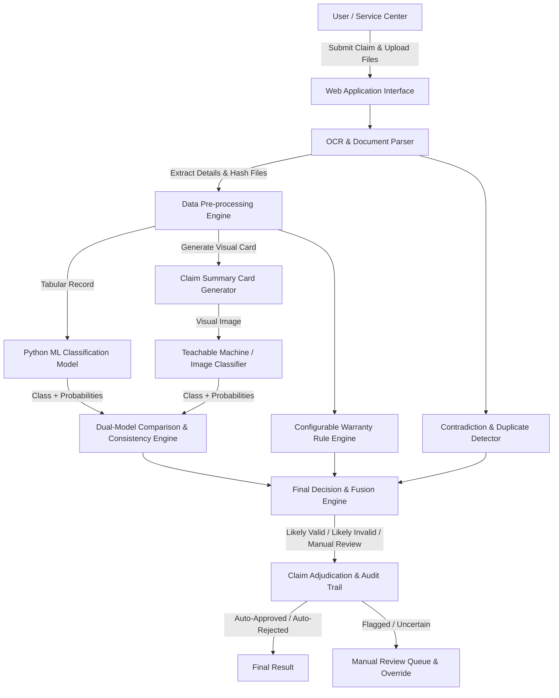
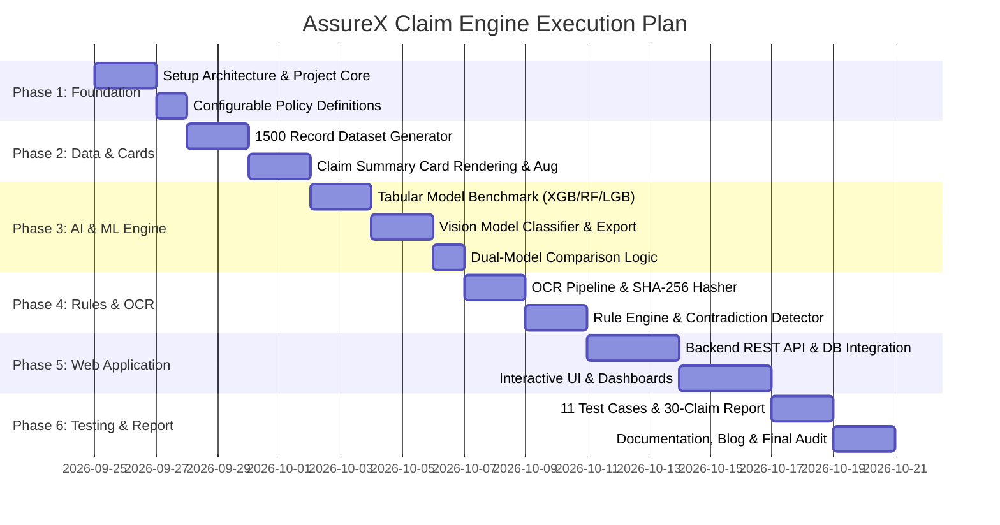

# AssureX Claim Engine - Requirements Breakdown & Execution Roadmap

> **Project Name:** AssureX Claim Engine  
> **Theme:** AI-Powered Document Ops  
> **Category:** NextWave AI and ML  
> **Specification Version:** 1.0  

---

## 1. System Architecture & Component Overview

The **AssureX Claim Engine** is an enterprise-grade AI-powered warranty claim processing and adjudication platform. It automates warranty evaluation by combining **Tabular Machine Learning**, **Computer Vision (Visual Summary Card Classifier)**, **OCR Document Extraction**, **Document Hashing**, and a **Configurable Business Rule Engine**.



---

## 2. Requirement Breakdown by Functional Modules

### Module 1: Authentication & Role-Based Access Control (RBAC)
- **Roles:** Customer, Service-Center Staff, Claim Reviewer, Administrator.
- **Features:**
  - Secure registration & login with hashed passwords.
  - Unique `User_ID` assignment.
  - Role-scoped page access and API endpoints.

### Module 2: Product & Warranty Registration & Tracking
- **Product Management:**
  - Register products with Name, Category, Brand, Model #, Serial #, Purchase Date, Purchase Price, Retailer, Warranty Duration. Assign unique `Product_ID`.
- **Warranty Policy Management:**
  - Track standard vs extended warranty.
  - Automatic status calculation: `Active`, `Expired`, `Nearing Expiry`, `Extended`.
  - Configurable expiration alerts (e.g. 30 days prior).

### Module 3: OCR & Document Extraction Pipeline
- **Upload Types:** Purchase Receipt/Invoice, Warranty Card, Product Photos, Damage Photos, Repair Reports (PDF, JPG, PNG).
- **Extraction Engine (Tesseract/EasyOCR/OpenCV):**
  - Extract: Purchase Date, Invoice #, Model #, Serial #, Retailer Name, Total Amount, Warranty Duration.
- **Verification UI:**
  - Side-by-side verification interface allowing users to inspect and correct extracted OCR data before submitting.
- **Document Hashing:**
  - Compute SHA-256 file hashes to prevent exact document re-use across different claims.

### Module 4: Dataset & Visual Summary Card Generator
- **Synthetic Dataset Specification:**
  - Total 1,500 unique claim records:
    - 500 `Valid Claim`
    - 500 `Invalid Claim`
    - 500 `Manual Review`
  - **Stratified Split:** 70% Training (1,050), 15% Validation (225), 15% Testing (225).
- **Claim Summary Card Generation:**
  - Script to programmatically render visual cards (PNG/JPG) summarizing product age, warranty status, fault category, repair history, receipt availability, serial status, missing docs.
  - **Crucial Rule:** Cards must **NOT** display Python model outputs or final decision labels.
  - **Data Augmentation/Variations:** Generate at least 2 visual variations per training record (minimum 2,100 training images) altering layout, fonts, colors, spacing, or date formats.

### Module 5: Python Tabular Machine Learning Engine
- **Preprocessing Pipeline:**
  - Missing value imputation, date parsing (derived features: `product_age_days`, `remaining_warranty_days`, `missing_doc_count`), categorical encoding (One-Hot / Ordinal), numerical scaling (`StandardScaler` / `RobustScaler`).
- **Algorithm Benchmarking:**
  - Train and evaluate at least 3 models: **XGBoost**, **Random Forest**, and **LightGBM / MLP**.
  - Evaluate using Accuracy, Precision, Recall, F1-Score, Confusion Matrix, and ROC/AUC.
- **Model Output:**
  - Predicts class (`Valid Claim`, `Invalid Claim`, `Manual Review`) and outputs 3-class probability distribution.

### Module 6: Computer Vision / Teachable Machine Model Integration
- **Training:**
  - Train an image classifier (Google Teachable Machine export or standalone Keras/TensorFlow MobileNet/ResNet model) using generated visual Claim Summary Cards.
- **Evaluation:**
  - Evaluates Summary Cards for unseen claims and outputs top class + 3-class confidence scores.

### Module 7: Dual-Model Comparison Engine
- **Metrics Calculation:**
  $$\text{Confidence Difference} = |\text{Python Model Top Confidence} - \text{GTM Top Confidence}|$$
- **Consistency Classification Rules:**
  - `Strong Match`: Same prediction, Confidence Difference $< 0.10$.
  - `Acceptable Match`: Same prediction, Confidence Difference $0.10 - 0.25$.
  - `Weak Match`: Same prediction, Confidence Difference $> 0.25$.
  - `Model Disagreement`: Different predicted classes.
  - `Uncertain Result`: Low absolute confidence $(< 0.60)$ on top class for either model.

### Module 8: Configurable Warranty Business Rule Engine
- **External Configuration:** Warranty policies stored in YAML/JSON files per product category (`electronics.json`, `appliances.json`, `automotive.json`).
- **Rule Checks:**
  - Warranty Expiry Check (`claim_date <= warranty_end_date`)
  - Purchase Proof Verification (`receipt_uploaded == True`)
  - Serial Number Match (`user_serial == ocr_serial == image_serial`)
  - Covered Fault Check (`fault_type` in policy `covered_faults`)
  - Excluded Damage Check (`damage_type` not in policy `exclusions`)
  - Authorized Service Center Check (`repair_history.authorized == True`)
  - Reporting Period Deadline Check

### Module 9: Contradiction & Duplicate Detection Engine
- **Contradictions:**
  - Claim date prior to purchase date.
  - Repair date prior to purchase date.
  - Fault date after claim submission date.
  - Inconsistent model numbers between invoice and product photo.
- **Duplicate Claim Detection:**
  - Match by exact document SHA-256 hash.
  - Match by combination of (`Serial Number` + `Invoice Number` + `Fault Category`).

### Module 10: Decision Fusion & Explanation Engine
- **Input Parameters:**
  - Python Model Class & Probabilities
  - Image Model Class & Probabilities
  - Model Consistency Status
  - Business Rule Validation Results
  - Contradictions & Duplicate Alerts
  - Missing Document Warnings
- **Outputs:**
  - Final Classification: `Likely Valid`, `Likely Invalid`, or `Manual Review Required`.
  - Human-Readable Decision Breakdown (Passed Rules, Failed Rules, Supporting Factors, Opposing Factors, Required Action).

### Module 11: Manual Review Queue & Audit Trail
- **Workflow:**
  - Auto-route claims with low confidence, model disagreement, rule failure, or duplicate alerts to the Reviewer Queue.
  - Reviewer can approve, reject, or request additional documents.
  - Allow Reviewer Override with mandatory comment logging.
  - Immutable Audit Log preserving original AI predictions, rule logs, and reviewer actions.

### Module 12: Admin Analytics & Downloadable Reports
- **Dashboards:**
  - Key Metrics: Total Claims, Valid/Invalid/Review ratios, Duplicate alerts, Model disagreement rate, Average confidence scores.
  - Interactive Search & Filter (by Claim ID, Product Category, Serial #, Date Range, Risk Score).
- **Exporting:**
  - PDF Claim Report Generation (Complete claim dossier with side-by-side model outputs & OCR verification).
  - Bulk Export (CSV / Excel).

---

## 3. Required Dataset Specifications

| Metric / Parameter | Requirement Specification |
| :--- | :--- |
| **Total Claim Records** | Minimum **1,500 unique claims** |
| **Class Balance** | **500 Valid Claim**, **500 Invalid Claim**, **500 Manual Review** |
| **Data Split** | **70% Train (1,050)**, **15% Validation (225)**, **15% Test (225)** |
| **Tabular Format** | Structured CSV / Parquet |
| **Visual Format** | rendered PNG/JPG Claim Summary Cards |
| **Card Variations** | **2+ visual style variations per training record** ($\ge 2,100$ train images) |
| **Data Leakage Rule** | Validation and Test claims must **NEVER** appear in training sets (neither CSV nor images) |

---

## 4. Mandatory Test Case Verification Scenarios

The system must be validated against at least these 11 mandatory test cases:

1. **Valid Claim Scenario:** All rules pass, high confidence, consistent models $\rightarrow$ `Likely Valid`
2. **Invalid Claim Scenario:** Clear warranty expiry / excluded damage $\rightarrow$ `Likely Invalid`
3. **Manual Review Scenario:** Borderline features $\rightarrow$ `Manual Review Required`
4. **Expired Warranty Claim:** Claim date $> 30$ days past warranty expiry $\rightarrow$ Hard Fail
5. **Missing Document Claim:** Mandatory purchase receipt missing $\rightarrow$ `Manual Review Required`
6. **Duplicate Claim Scenario:** Matching SHA-256 hash or duplicate Serial + Invoice
7. **Contradictory Claim Scenario:** Fault date recorded before product purchase date
8. **Serial Number Mismatch:** User entered serial # doesn't match OCR extracted serial #
9. **Unauthorized Repair Claim:** Previous repair executed by unauthorized third-party center
10. **Tricky Boundary Date Claim:** Claim filed on the exact last day of warranty coverage
11. **Model Disagreement Scenario:** Tabular model predicts Valid, Image model predicts Invalid $\rightarrow$ Auto-route to Manual Review

---

## 5. Repository Structure & Deliverables Matrix

```
assurex-claim-engine/
│
├── README.md                          # Complete setup, execution, architecture guide
├── AI_USAGE.md                        # Transparency declaration of AI tool usage
├── requirements.txt                   # Complete Python dependencies
├── pyproject.toml                     # Package definition & configuration
├── LICENSE                            # License file
│
├── config/                            # Global app configuration files
│   └── settings.yaml
├── policies/                          # Business Rule Engine JSON/YAML policies
│   ├── electronics_policy.json
│   ├── appliances_policy.json
│   └── automotive_policy.json
│
├── dataset_generator/                 # Dataset synthesis & card rendering scripts
│   ├── generate_dataset.py
│   ├── generate_summary_cards.py
│   └── scenario_definitions.py
│
├── data/                              # Raw, preprocessed, and split dataset files
│   ├── raw/
│   ├── processed/
│   ├── train.csv
│   ├── val.csv
│   ├── test.csv
│   └── summary_cards/                 # Image folders: train/, val/, test/
│
├── notebooks/                         # Model training & benchmarking EDA notebooks
│   ├── 01_eda_and_preprocessing.ipynb
│   ├── 02_python_model_benchmarking.ipynb
│   └── 03_teachable_machine_evaluation.ipynb
│
├── model/                             # Saved ML models, encoders, and scalars
│   ├── best_python_model.joblib
│   ├── scaler.joblib
│   ├── encoder.joblib
│   └── image_classifier/              # Exported Keras/ONNX/TM model & labels.txt
│
├── database/                          # DB scripts, schema migrations, seed data
│   ├── schema.sql
│   └── seed_data.py
│
├── src/                               # Application Core Source Code
│   └── assurex_claim_engine/
│       ├── __init__.py
│       ├── auth/                      # User authentication & RBAC
│       ├── ocr/                       # Tesseract/EasyOCR & Hash utility
│       ├── rule_engine/               # Warranty business rule evaluator
│       ├── models/                    # ML Inference wrappers (Tabular & Vision)
│       ├── decision/                  # Decision Fusion & Comparison Engine
│       ├── db/                        # Database interactions & models
│       ├── utils/                     # PDF/Report generator & helpers
│       └── web/                       # FastAPI / Flask / Streamlit web app
│
├── templates/ & static/               # Frontend assets (HTML, CSS, JS) if web stack
├── tests/                             # Comprehensive test suite (11 mandatory cases)
│   ├── test_ocr.py
│   ├── test_rule_engine.py
│   ├── test_ml_models.py
│   ├── test_contradictions.py
│   └── test_scenarios.py
│
├── sample_claims/                     # Sample receipts, claim images, and PDFs
├── screenshots/                       # Application UI screenshots
├── reports/                           # 30-Claim Model Comparison Report PDF/MD
└── documentation/                     # DFD, Use Case, Sequence Diagrams, Project Report
```

---

## 6. Comprehensive Execution Roadmap



### Phase 1: Architecture & Policy Infrastructure
1. Create project folder structure and setup virtual environment with all required packages (`scikit-learn`, `xgboost`, `lightgbm`, `opencv-python`, `pillow`, `pytesseract`, `easyocr`, `fastapi`, `uvicorn`, `pandas`, `jinja2`, `reportlab`, etc.).
2. Define JSON/YAML policy configuration files for standard product categories (`electronics`, `appliances`, `automotive`).

### Phase 2: Dataset Generator & Summary Card Rendering
1. Build `dataset_generator/generate_dataset.py` to programmatically output 1,500 balanced claim records with real-world claim complexities (normal, incomplete, contradictory, serial mismatch, expired warranty).
2. Create `dataset_generator/generate_summary_cards.py` using `Pillow` or `Matplotlib` to convert tabular claims into visually appealing Claim Summary Cards. Generate 2+ variations for training images.
3. Perform 70/15/15 stratified train/val/test split.

### Phase 3: Machine Learning & Vision Classifier Development
1. Build Jupyter Notebook `01_eda_and_preprocessing.ipynb` to clean data, engineer derived features (`product_age_days`, `remaining_warranty_days`, `missing_doc_count`), and encode fields.
2. Build `02_python_model_benchmarking.ipynb` to train and compare **Random Forest**, **XGBoost**, and **LightGBM**. Export the top model (`best_python_model.joblib`), scaler, and label encoders to `model/`.
3. Train and export the visual Claim Summary Card image classifier (`model/image_classifier/`).
4. Build `src/assurex_claim_engine/decision/comparison.py` to calculate confidence difference and model consistency status (`Strong Match`, `Acceptable Match`, `Weak Match`, `Model Disagreement`, `Uncertain Result`).

### Phase 4: Document OCR & Business Rule Engine
1. Implement OCR pipeline (`src/assurex_claim_engine/ocr/`) using EasyOCR/Tesseract with pattern extraction for dates, amounts, serial numbers, and invoice IDs. Add SHA-256 hashing for duplicate document detection.
2. Build business rule engine (`src/assurex_claim_engine/rule_engine/`) to evaluate rules against policy configs.
3. Build contradiction and duplicate claim detection module (`src/assurex_claim_engine/decision/contradiction.py`).
4. Implement final Decision Fusion engine (`src/assurex_claim_engine/decision/fusion.py`) to synthesize model scores, rule results, and flags into `Likely Valid`, `Likely Invalid`, or `Manual Review Required`.

### Phase 5: Web Application Development
1. Build database schema and persistence layer (`SQLite`/`PostgreSQL` via `SQLAlchemy`).
2. Build backend APIs/controllers (using FastAPI / Flask / Streamlit) for user authentication, product registration, claim intake, document upload, OCR verification, decision evaluation, manual review queue, and admin analytics.
3. Develop responsive frontend views with modern dark/glassmorphic aesthetics:
   - User Portal (Product/Warranty List, Claim Intake, OCR side-by-side edit)
   - Adjudication Dossier (Visual Card preview, Python vs Vision model gauge breakdown, Rule checklist, Decision summary)
   - Manual Review Queue (Reviewer comments & override modal)
   - Admin Analytics Dashboard (Charts, filtering, CSV/PDF report download)

### Phase 6: Verification, 30-Claim Report, & Final Deliverables
1. Implement comprehensive test suite in `tests/` covering all 11 mandatory test scenarios.
2. Generate the **30-Claim Model Comparison Report** (`reports/model_comparison_report.md` / PDF) detailing actual class, predicted classes, confidence scores, consistency status, rule outcomes, and final decisions.
3. Prepare documentation: `README.md`, `AI_USAGE.md`, API docs, system design diagrams, and 2,000+ word Technical Blog post.

---
*AssureX Claim Engine Specifications - Prepared for Aptech Technical Evaluation.*
